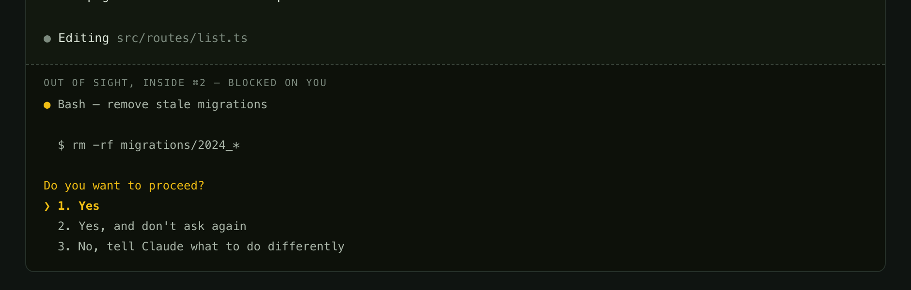
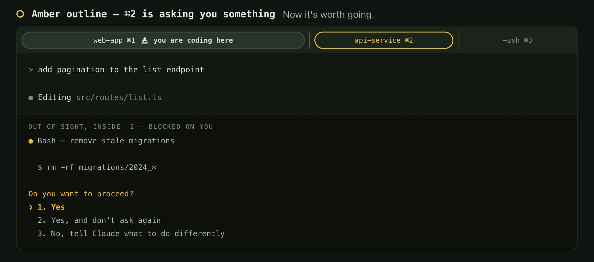
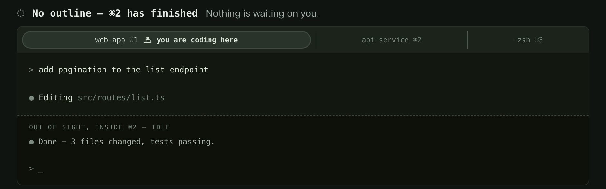
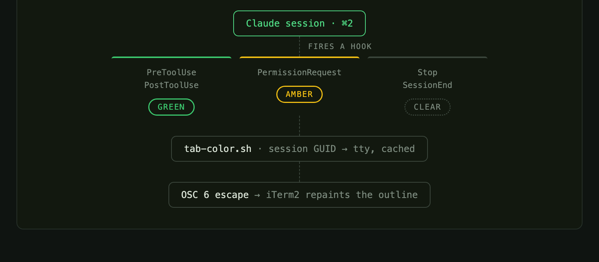

# A visual peek inside the tab you're not in

## The problem

Two projects, two Claude sessions in two different tabs. *(Trying to make the most use of
Claude, building two projects at a time 😅 — we call them an ultra max developer.)*

You run the process in one tab and switch to the other. You assume the quiet one is still
working when it has actually been waiting the whole time for a yes/no. Nothing in the tab
bar tells them apart, so the only way to know is to switch over and look — again and again.

That is so irritating. So what if we get a visual clue on what is happening inside the
other tab…

## The fix

The other tab outlines itself according to what it's doing. You stay where you are and
read it out of the corner of your eye — three states, no tab switching.







Only a background tab draws as an outline; the tab in front is filled instead. That's the
part that matters — you learn what the other tab is doing without going there.

## Set it up

```sh
git clone git@github.com:codereyinish/dotfiles.git
cd dotfiles && ./install.sh
```

Needs iTerm2. Say yes when macOS asks to control it. Replaces `~/.claude/settings.json`,
keeping a copy of the old one.

## How it's wired



Nine hook events, one 32-line script, no daemon and nothing polling.

## Next

Colour still needs your eyes on the tab bar. The next step is the amber tab pulling itself
to the front the moment it asks — an AppleScript on `PermissionRequest` that matches the
session GUID and selects that tab.
