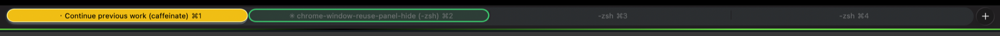

# dotfiles

Personal config, kept in git so it survives a machine loss.

## Claude Code — iTerm tab colours

Two projects, two Claude sessions in two different tabs. You run the process in one tab
and switch to the other. You assume the quiet one is still working when it has actually
been waiting the whole time for a yes/no. Nothing in the tab bar tells them apart, so the
only way to know is to switch over and look — again and again.

So the tab says it itself. You stay in the tab you're working in, and the tab you're *not*
in reports what it's doing as an outline.


Only a background tab draws as an outline; the tab in front is filled instead. That's the
part that matters — you learn what the other tab is doing without going there.

Running for real:



## Usage

```sh
./install.sh   # repo  -> ~/.claude/   (run on a new machine)
./backup.sh    # ~/.claude/ -> repo    (run after editing config, then commit)
```

Needs iTerm2. Say yes when macOS asks for permission to control it, or the tabs stay grey.
`install.sh` replaces `~/.claude/settings.json` and keeps a dated `.replaced-*` copy of
whatever was there.

## How it works

`claude/settings.json` wires nine Claude Code hook events to `claude/tab-color.sh`:

| Event | Colour |
|---|---|
| `UserPromptSubmit`, `PreToolUse`, `PostToolUse`, `PostToolUseFailure`, `PermissionDenied` | green |
| `PermissionRequest`, `Notification` | amber |
| `Stop`, `SessionEnd` | clear |

The script writes iTerm2 `OSC 6` escape codes to the session's TTY. It finds that TTY once
via AppleScript — matching `$ITERM_SESSION_ID` against iTerm's own session id — and caches
it at `~/.claude/.tty-$GUID`, so colour changes are instant afterwards. No daemon, nothing
polling.

## Notes

- Claude Code updates install to `~/.local/share/claude/versions/` and never touch
  `~/.claude/`, so this config survives upgrades.
- Hook event names are the one upgrade risk: if a future version renames one, that colour
  change silently stops happening. Nothing errors — it just stops.
- If `settings.json` ever fails to parse, Claude Code ignores the **entire** file, not just
  the broken part. `install.sh` checks this with `jq` and warns.

## Next

Colour still needs your eyes on the tab bar. The next step is the amber tab pulling itself
to the front the moment it asks — an AppleScript on `PermissionRequest` that matches the
session GUID and selects that tab.
